# Multi-Site Enterprise Network (Cisco Packet Tracer)

A two-site enterprise network built in Cisco Packet Tracer. Headquarters runs a redundant Layer 3 core, a firewall, two edge routers and two ISP connections. A Sales branch connects back to HQ over two separate WAN carriers. Every feature was verified with show commands and end-to-end tests, and both redundancy paths were tested by failing devices and links on purpose.

The project also includes a troubleshooting log of 16 real issues found and fixed during the build, written the way a support or NOC ticket would be.

| Start here | |
|---|---|
| [Troubleshooting log](docs/troubleshooting-log.md) | 16 tickets, from an HSRP split-brain to an asymmetric return path found during failover testing |
| [Design decisions](docs/design-decisions.md) | Why the network is built this way, and the hostname convention |
| [Lab vs Production](#lab-vs-production) | What would change on real hardware |
| [Packet Tracer file](multi-site-enterprise-network-lab.pkt) | Open the lab in Cisco Packet Tracer 9.0 or later |

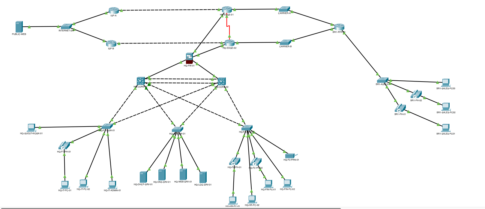
*Full topology: internet edge and dual ISPs (top), HQ campus (left), Sales branch over two carriers (right).*

## Highlights

| Area | What was built |
|---|---|
| Switching | 9 VLANs, 802.1Q trunks with a dedicated native VLAN, pruned allowed lists, voice VLANs for IP phones |
| Core redundancy | Two Catalyst 3650 core switches, EtherChannel between them, HSRPv2 with load-balanced active roles and preemption, STP root aligned with each HSRP active gateway |
| Routing | OSPF between the HQ edge routers and the branch router, cost-based primary and backup WAN paths, default route injected from HQ |
| WAN redundancy | Dual carriers to the branch, automatic failover with no manual changes |
| Internet | Dual ISPs, PAT on both edge routers |
| Firewall | Cisco ASA between the core and both edge routers, with redundant inside and outside interfaces and an inbound ACL |
| Security | Per-department inbound ACLs, guest isolation, port security, DHCP snooping, Dynamic ARP Inspection, BPDU guard, SSH-only management restricted to the management VLAN, unused ports shut down |
| Services | Centralized DHCP for both sites (via relay), DNS, centralized syslog and NTP |
| Troubleshooting | 16 documented tickets, including an HSRP split-brain caused by config drift, EtherChannel instability, NAT sessions split across two exits, and a firewall return-path gap exposed by failover testing |

## Sites and Devices

| Site | Role | Devices |
|---|---|---|
| HQ | Internet edge | ISP-A, ISP-B, HQ-EDGE-01, HQ-EDGE-02 |
| HQ | Security | HQ-FW-01 |
| HQ | Core / distribution | HQ-CORE-01, HQ-CORE-02 (Catalyst 3650) |
| HQ | Access | HQ-F1-ASW-01 (floor 1), HQ-F2-ASW-01 (floor 2), HQ-SRV-SW-01 (servers) |
| HQ | Servers | HQ-DHCP-SRV-01, HQ-DNS-SRV-01, HQ-WEB-SRV-01, HQ-LOG-SRV-01 |
| HQ | Endpoints | IT, IT admin, HR, Finance, guest kiosk, IP phones, HQ-F2-PRN-01 (HR printer) |
| WAN | Carriers | CARRIER-A (primary), CARRIER-B (backup) |
| Branch | Routing | BR1-RTR-01 |
| Branch | Access | BR1-ASW-01, BR1-PH-01/02, BR1-SALES-PC01 to PC03 |

Hostnames follow `SITE-LOCATION-ROLE-NUMBER` (for example `HQ-F2-ASW-01` is the HQ floor 2 access switch). The full convention is in [design decisions](docs/design-decisions.md#naming).

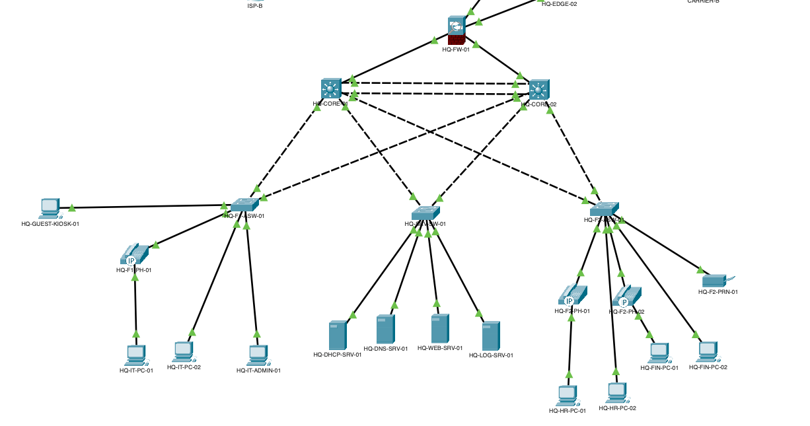
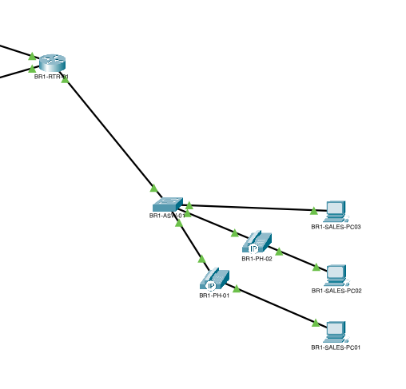

## Addressing

### HQ VLANs

| VLAN | Name | Subnet | Gateway (HSRP VIP) | Active core |
|---|---|---|---|---|
| 10 | IT | 10.1.10.0/24 | 10.1.10.1 | HQ-CORE-01 |
| 20 | HR | 10.1.20.0/24 | 10.1.20.1 | HQ-CORE-02 |
| 30 | FINANCE | 10.1.30.0/24 | 10.1.30.1 | HQ-CORE-02 |
| 50 | SERVERS | 10.1.50.0/24 | 10.1.50.1 | HQ-CORE-01 |
| 60 | VOICE | 10.1.60.0/24 | 10.1.60.1 | HQ-CORE-01 |
| 70 | GUEST_WIFI | 10.1.70.0/24 | 10.1.70.1 | HQ-CORE-02 |
| 99 | MANAGEMENT | 10.1.99.0/24 | 10.1.99.1 | HQ-CORE-01 |
| 999 | NATIVE | n/a | n/a | n/a |

HQ-CORE-01 uses .2 and HQ-CORE-02 uses .3 in every VLAN. Switch management addresses are in VLAN 99: HQ-F1-ASW-01 (.11), HQ-SRV-SW-01 (.12), HQ-F2-ASW-01 (.13). The HR printer uses a static address, 10.1.20.10.

### Branch VLANs

| VLAN | Name | Subnet | Gateway |
|---|---|---|---|
| 40 | SALES | 10.2.40.0/24 | 10.2.40.1 (BR1-RTR-01 Gi0/0.40) |
| 60 | VOICE | 10.2.60.0/24 | 10.2.60.1 (BR1-RTR-01 Gi0/0.60) |
| 99 | MANAGEMENT | 10.2.99.0/24 | 10.2.99.1 (BR1-RTR-01 Gi0/0.99) |

### Point-to-Point and Public Links

| Link | Subnet | Addresses |
|---|---|---|
| HQ-EDGE-01 to BR1-RTR-01 (Carrier-A) | 172.16.0.0/30 | .1 / .2 |
| HQ-EDGE-02 to BR1-RTR-01 (Carrier-B) | 172.16.0.4/30 | .5 / .6 |
| HQ-EDGE-01 to HQ-EDGE-02 (serial) | 172.16.0.8/30 | .9 / .10 |
| HQ-EDGE-01 to HQ-FW-01 (outside1) | 172.16.1.0/30 | .1 / .2 |
| HQ-EDGE-02 to HQ-FW-01 (outside2) | 172.16.1.4/30 | .5 / .6 |
| HQ-FW-01 (inside1) to HQ-CORE-01 | 172.16.2.0/30 | .1 / .2 |
| HQ-FW-01 (inside2) to HQ-CORE-02 | 172.16.2.4/30 | .5 / .6 |
| HQ-EDGE-01 to ISP-A | Public | 203.0.113.2 |
| HQ-EDGE-02 to ISP-B | Public | 198.51.100.2 |
| Internet test server (PUBLIC-WEB) | Public | 192.0.2.10 |

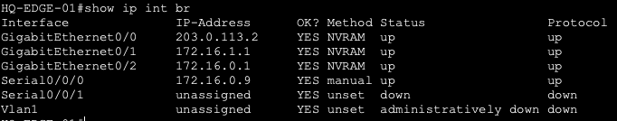

## 1. VLANs and Trunking

Each floor has its own access switch carrying only the VLANs it needs. Trunks use VLAN 999 as the native VLAN, and each core uplink allows only the VLANs used behind it. IP phones sit between the switch and the PC, so each phone port carries a data VLAN plus voice VLAN 60.

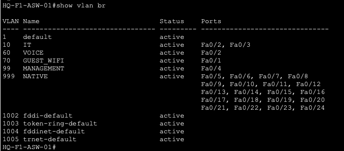
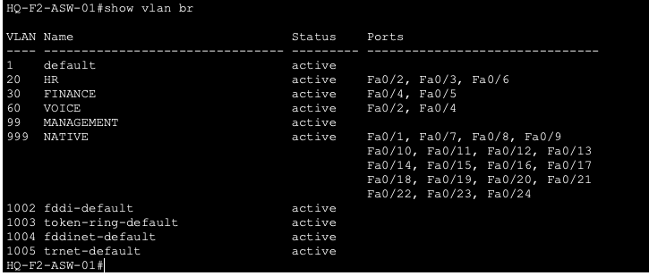
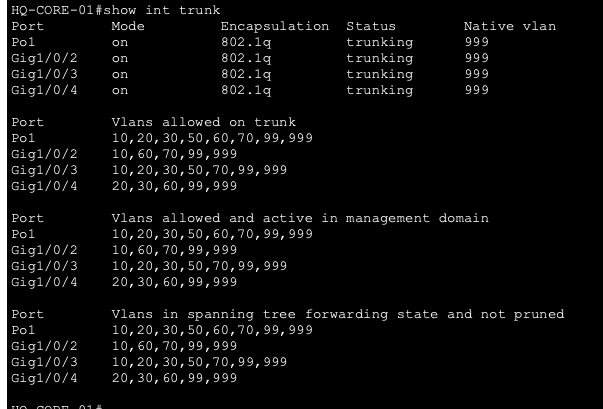
*Native VLAN 999 on every trunk. Floor 1 uplink carries 10/60/70/99, floor 2 uplink carries 20/30/60/99.*

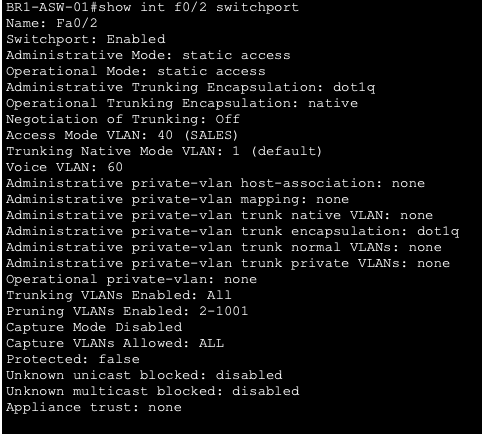
*Branch phone port: data VLAN 40 (Sales) plus voice VLAN 60.*

Every unused port, on the access switches and the cores, is described as UNUSED, placed in VLAN 999 and administratively shut down. All trunks are static (`switchport nonegotiate`), and VTP runs in transparent mode.

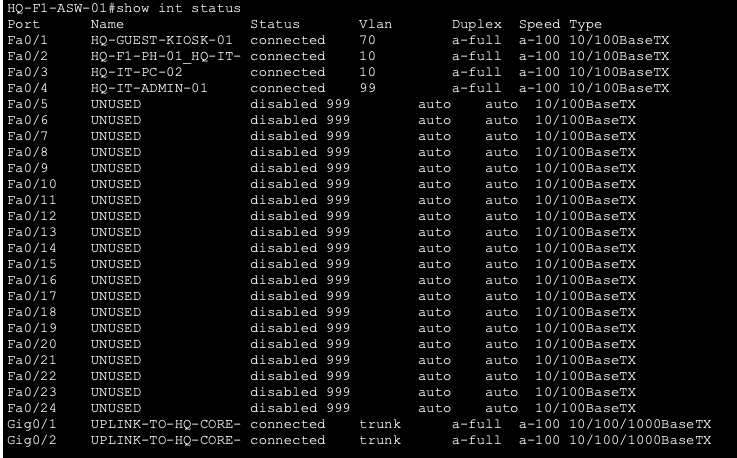
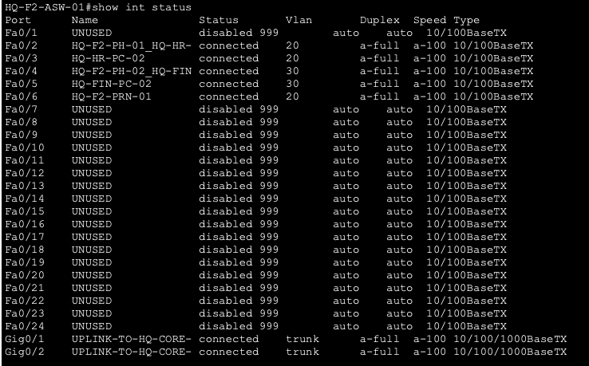
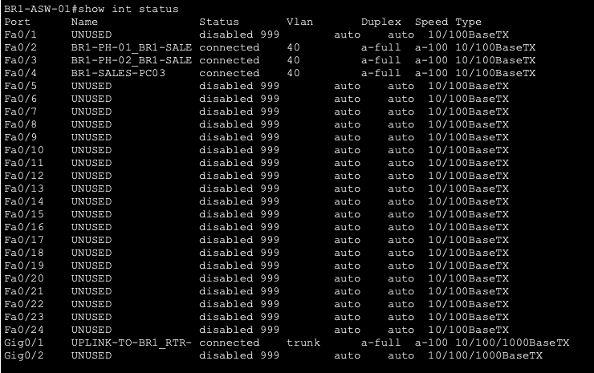

### Layer 2 Security

The access switches at both sites (HQ-F1-ASW-01, HQ-F2-ASW-01 and BR1-ASW-01) harden every user port. The full settings are in the [configs](configs/) folder.

| Feature | Setting | What it protects against |
|---|---|---|
| Port security | Sticky MACs, maximum 2 per port (3 on phone ports), violation restrict | Unknown devices plugged into a user port |
| DHCP snooping | Enabled on all user VLANs, uplinks and the DHCP server port trusted, 12 to 15 packets/sec rate limit | Rogue DHCP servers and DHCP starvation |
| Dynamic ARP Inspection | Enabled on user VLANs, uplinks trusted, printer port trusted because it uses a static IP | ARP spoofing and man-in-the-middle attacks |
| PortFast and BPDU guard | On every access port | Loops from a switch plugged into a user port |

## 2. EtherChannel

The two core switches are joined by Port-channel 1 (Gi1/0/23 and Gi1/0/24), giving the inter-core trunk double bandwidth and link redundancy.

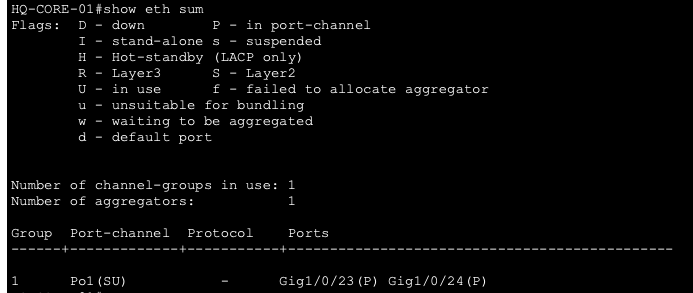

## 3. Inter-VLAN Routing and HSRP

HQ inter-VLAN routing runs on SVIs on both core switches. HSRP gives each VLAN a virtual gateway (.1). Active roles are split across the cores so both carry traffic: HQ-CORE-01 is active for VLANs 10, 50, 60 and 99, and HQ-CORE-02 is active for VLANs 20, 30 and 70. Preemption returns each group to its preferred core after a failure. HSRP runs version 2.

Spanning tree (Rapid PVST+) is tuned to match: each core is the root bridge for the same VLANs it is HSRP active for, so Layer 2 and Layer 3 paths line up and traffic never crosses the core-to-core link just to reach its gateway.

| Core | HSRP active and STP root for | STP priority |
|---|---|---|
| HQ-CORE-01 | VLANs 10, 50, 60, 99 (and 999) | 24576 |
| HQ-CORE-02 | VLANs 20, 30, 70 | 24576 |

Each core sends its default route to HQ-FW-01, with a floating backup route (AD 10) through the other core over VLAN 99.

The branch uses router-on-a-stick on BR1-RTR-01.

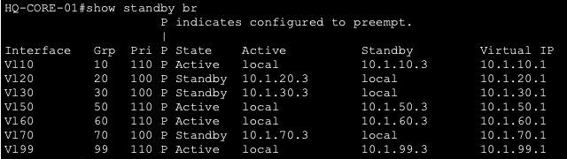
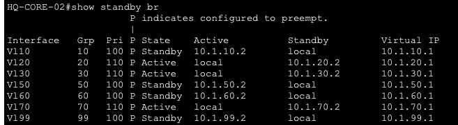
*Final HSRP state after the TKT-001 fix. Each core is active for its assigned VLANs and standby for the rest.*

## 4. Firewall

HQ-FW-01 (ASA) sits between the core and the internet edge. Each edge router connects to its own outside interface, and each core connects to its own inside interface, so losing any single edge router or core switch still leaves a path through the firewall.

| Element | Configuration |
|---|---|
| Interfaces | outside1 (to HQ-EDGE-01) and outside2 (to HQ-EDGE-02) at security level 0, inside1 (to HQ-CORE-01) and inside2 (to HQ-CORE-02) at level 100 |
| Routing | 10.1.0.0/16 through Core-01 (primary) or Core-02 (backup). Default route through EDGE-01 (primary) or EDGE-02 (backup). |
| OUTSIDE_IN ACL | Allows the branch (10.2.0.0/16) into HQ, branch DHCP relay to the DHCP server, and ICMP replies and unreachables |
| Inspection | DNS, FTP, HTTP, ICMP, TFTP |
| Management | SSH only from the management subnet (10.1.99.0/24) |

## 5. OSPF

OSPF runs between HQ-EDGE-01 (1.1.1.1), HQ-EDGE-02 (2.2.2.2) and BR1-RTR-01 (3.3.3.3). Both edge routers redistribute their static route to the HQ campus (10.1.0.0/16) and originate a default route, so the branch learns both as external type 2 routes through either carrier.

| Design choice | How |
|---|---|
| Carrier-A is primary | OSPF cost 10 on the Carrier-A link, 100 on Carrier-B |
| Backup routes held in reserve | BR1-RTR-01 sets AD 111 for routes learned from HQ-EDGE-02, so they only install when Carrier-A fails |
| No OSPF on user subnets | Branch LAN subinterfaces are passive |
| EDGE-02 reaches HQ through EDGE-01 | EDGE-02's route to 10.1.0.0/16 goes over the serial link to EDGE-01, with a floating static (AD 200) through the firewall as a last resort. This is why the backup path in Test B has 6 hops. |

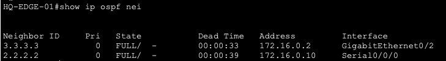
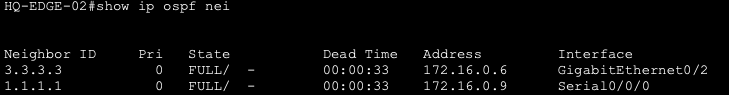
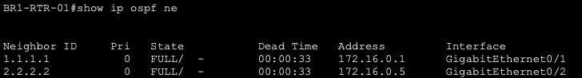
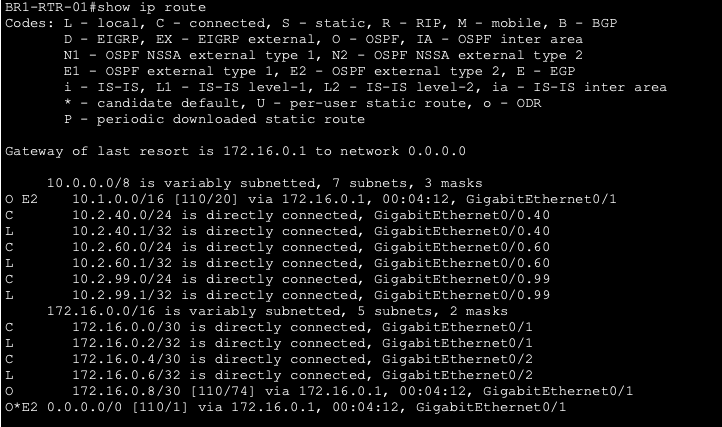
*Normal state: the branch reaches HQ and the internet through Carrier-A (172.16.0.1).*

## 6. NAT

Both edge routers run PAT on their ISP-facing interface (Gi0/0). ACL 1 matches all internal 10.0.0.0/8 traffic, which covers both sites, so branch internet traffic breaks out through HQ.

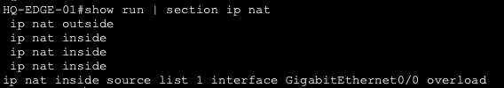
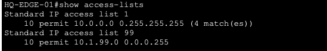
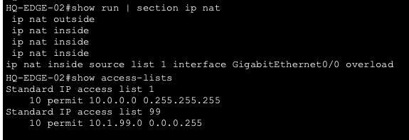
*HQ-EDGE-02 runs a matching NAT config so it can take over internet traffic.*

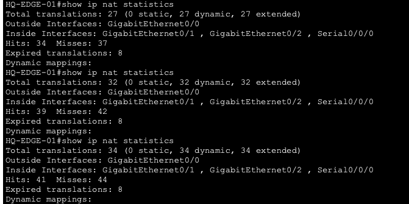
*Active translations climbing on HQ-EDGE-01 during a test.*

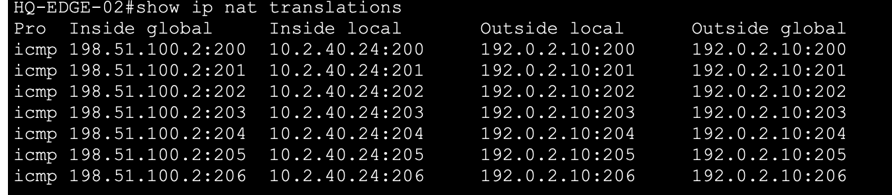
*During the WAN failover test, branch PC 10.2.40.24 is translated to 198.51.100.2 on HQ-EDGE-02.*

## 7. DHCP and DNS

HQ-DHCP-SRV-01 (10.1.50.10) serves every VLAN at both sites from one server. Clients in other VLANs reach it through DHCP relay (`ip helper-address 10.1.50.10` on the core SVIs and the branch router subinterfaces). Every pool hands out the HSRP virtual IP as the gateway and HQ-DNS-SRV-01 (10.1.50.11) as DNS. The department ACLs explicitly permit DHCP (bootps) so leases keep working.

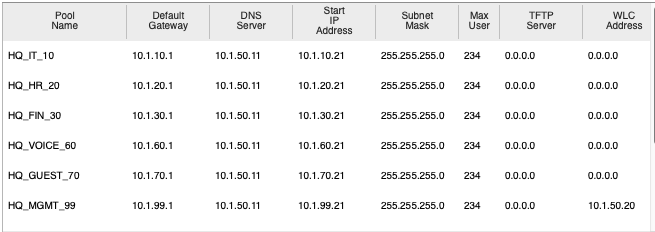
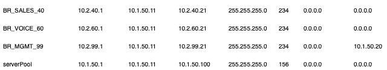
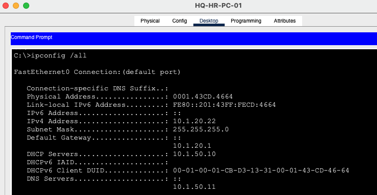
*An HR PC receiving its address, the HSRP gateway 10.1.20.1, and DNS from the central servers.*

## 8. Access Control Lists

Inbound ACLs on the HR, Finance and Guest SVIs enforce department separation. The same ACLs are applied on both cores, so the policy holds during a failover.

| ACL | Allowed | Blocked |
|---|---|---|
| HR_IN | DHCP, HR to HR, HR to servers, return traffic from the HR printer (10.1.20.10) to Finance, internet | All other internal networks |
| FIN_IN | DHCP, Finance to Finance, Finance to servers, Finance to the HR printer (10.1.20.10), internet | All other internal networks |
| GUEST_IN | DHCP, guest to guest, DNS to 10.1.50.11 only, internet | All internal networks |

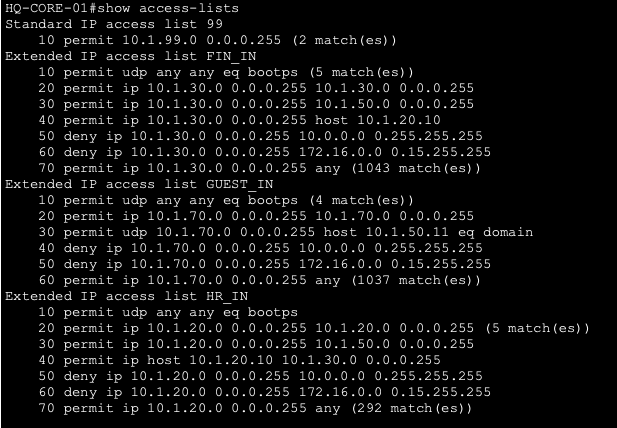
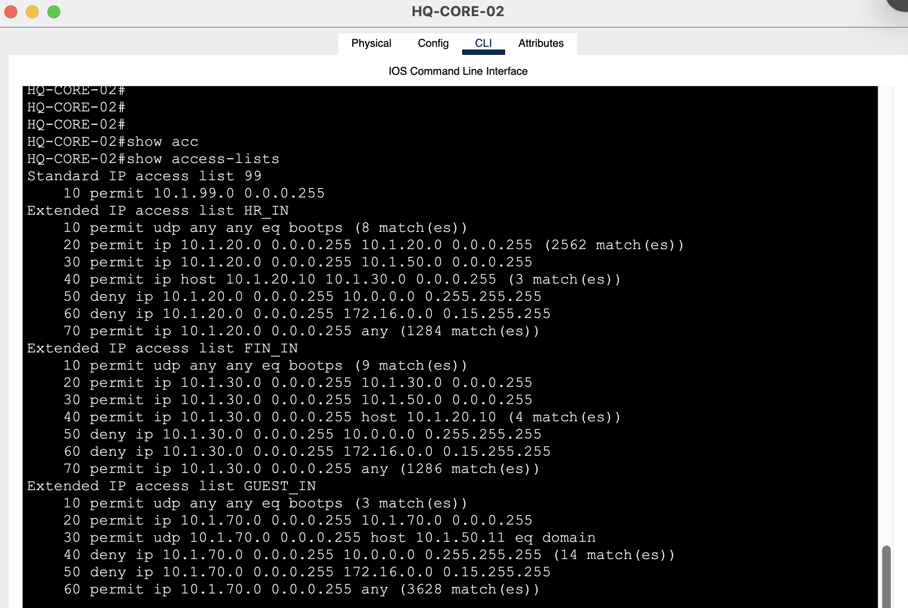
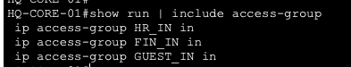
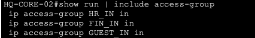

### ACL Verification

| Test | Expected | Result | Screenshot |
|---|---|---|---|
| Finance to HR printer 10.1.20.10 | Permit (FIN_IN 40) | Pass | 09-test-fin-to-shared-host-permit |
| Finance to HR PC 10.1.20.22 | Deny (FIN_IN 50) | Pass | 09-test-fin-to-hr-deny |
| Guest to HR PC 10.1.20.22 | Deny (GUEST_IN 40) | Pass | 09-test-guest-to-hr-deny |
| Guest to internet | Permit (GUEST_IN 60) | Pass | 09-test-guest-internet-permit |
| HR to HR | Permit (same VLAN) | Pass | 13-tkt002-03-hr-ping-success |

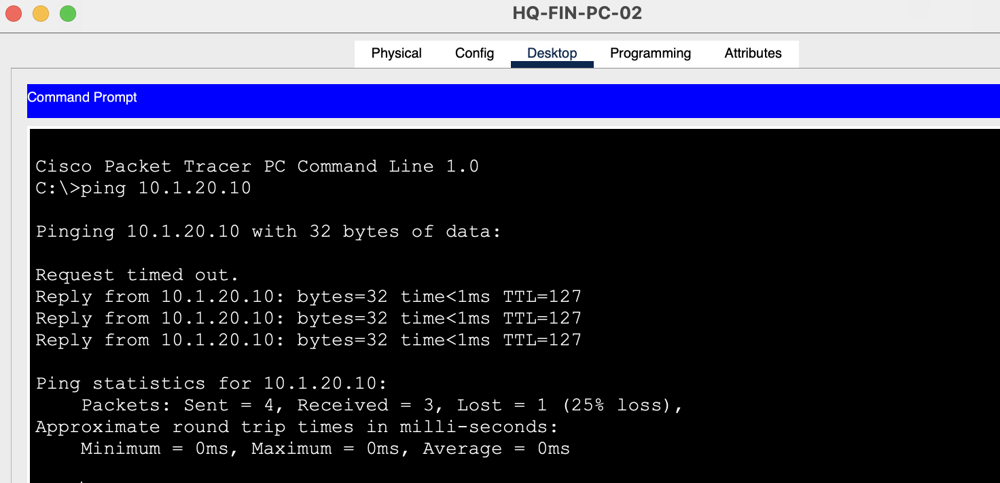
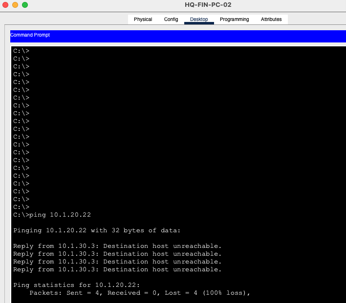
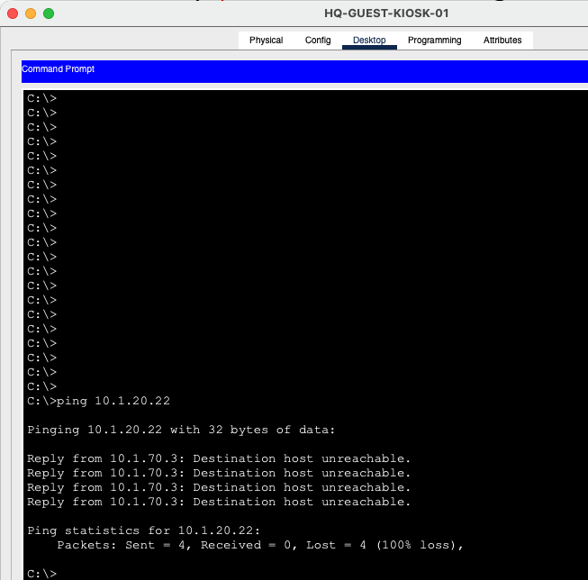
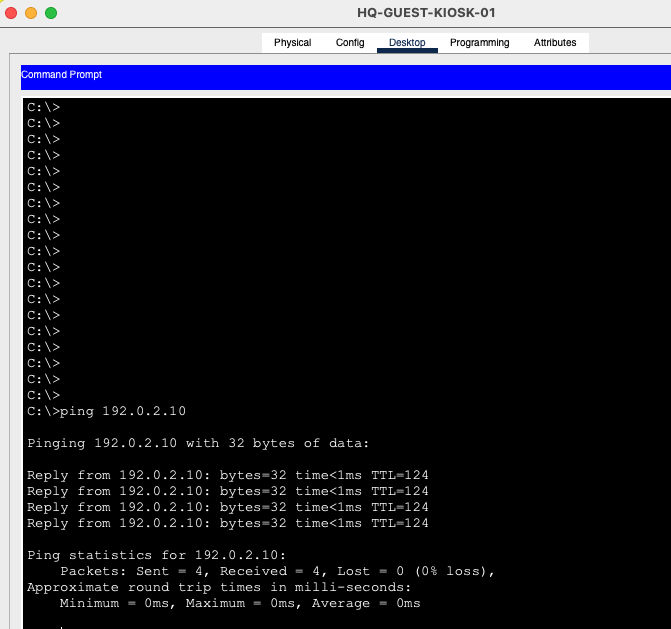

## 9. Management and Monitoring

Device management is SSH only, with local login. The VTY lines only accept connections from the management subnet (ACL 99, 10.1.99.0/24). An HR PC is stopped even earlier: HR_IN drops the traffic before it reaches the VTY ACL, giving two layers of protection.

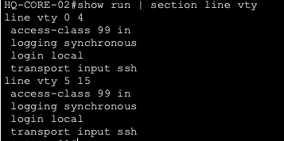
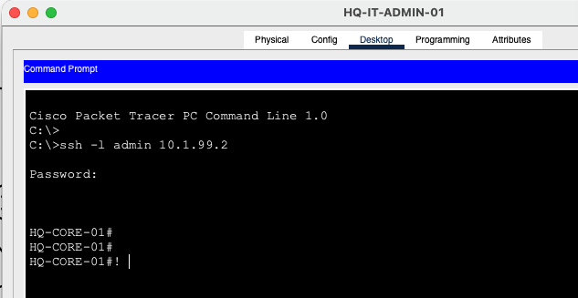
*HQ-IT-ADMIN-01 (VLAN 99) logs in to HQ-CORE-01.*

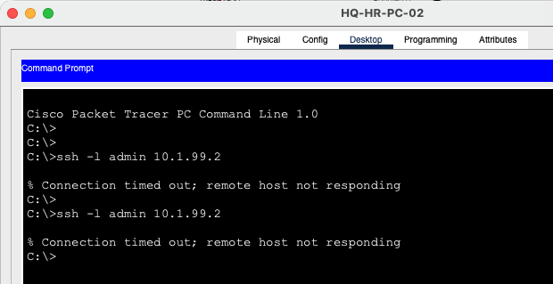
*HQ-HR-PC-02 cannot reach the core over SSH.*

Network devices at both sites send logs to HQ-LOG-SRV-01 (10.1.50.13). The server shows config changes from the cores (10.1.50.2), the HQ access layer (10.1.99.11) and the branch switch (10.2.99.11), plus the HSRP state changes recorded during failover testing.

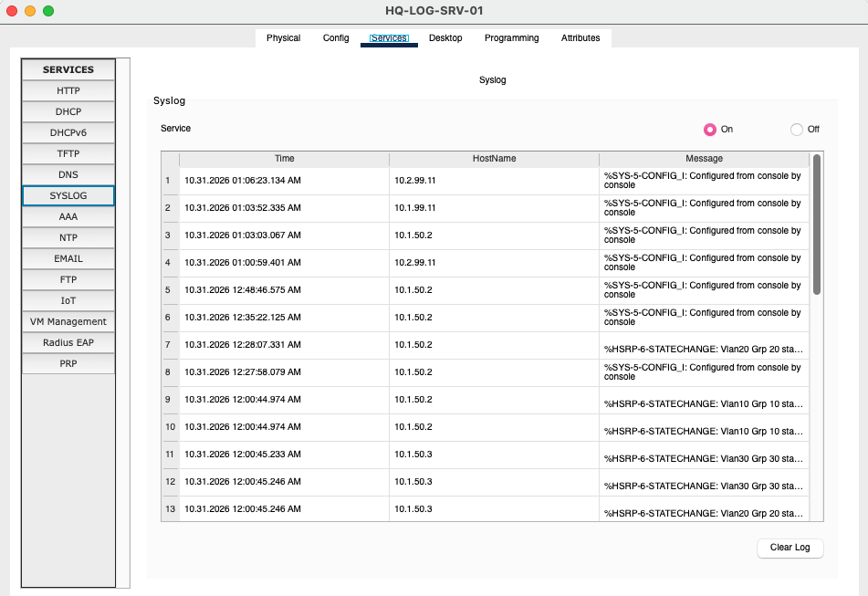

HQ-LOG-SRV-01 also serves NTP to every device, so log timestamps line up across both sites. SNMP v2c read-only is enabled for monitoring.

## 10. Failover Testing

### Test A: HQ Core Switch Failure

HQ-CORE-01 was taken offline while HQ-IT-PC-02 ran a continuous ping to the internet.

| Stage | Observation | Screenshot |
|---|---|---|
| Baseline | Continuous ping to 192.0.2.10 succeeding | 11a |
| Failure | All Core-01 links down, access uplinks fail over to Core-02 | 11b, 11c |
| During | About 7 pings lost while HSRP moved, then traffic resumed | 11d |
| During | HQ-CORE-02 active for all 7 HSRP groups | 11e |
| Recovery | Core-01 boots and preempts its groups back (10, 50, 60, 99) | 11f |
| After | Active roles back to the designed split | 11g |

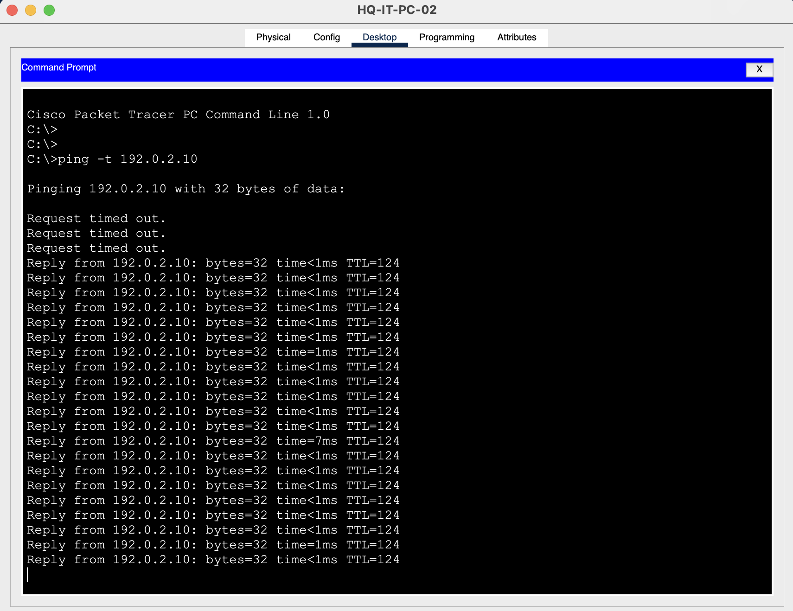
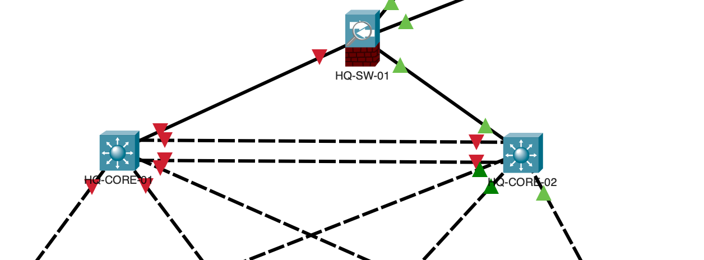
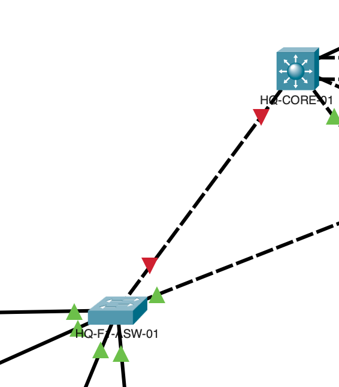
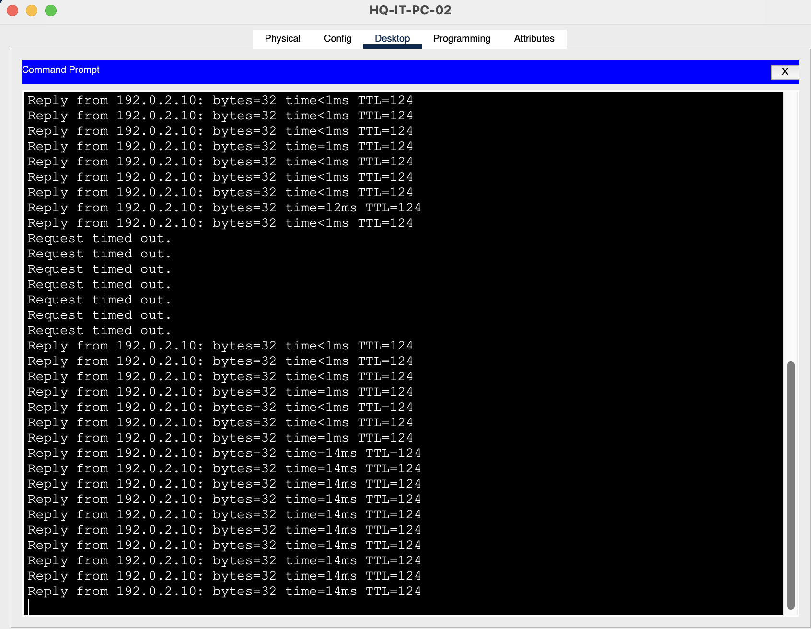
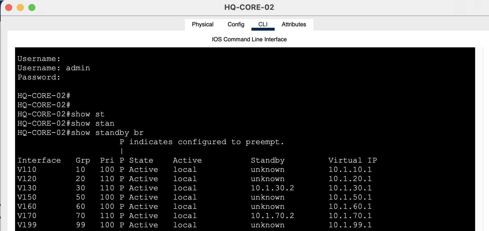
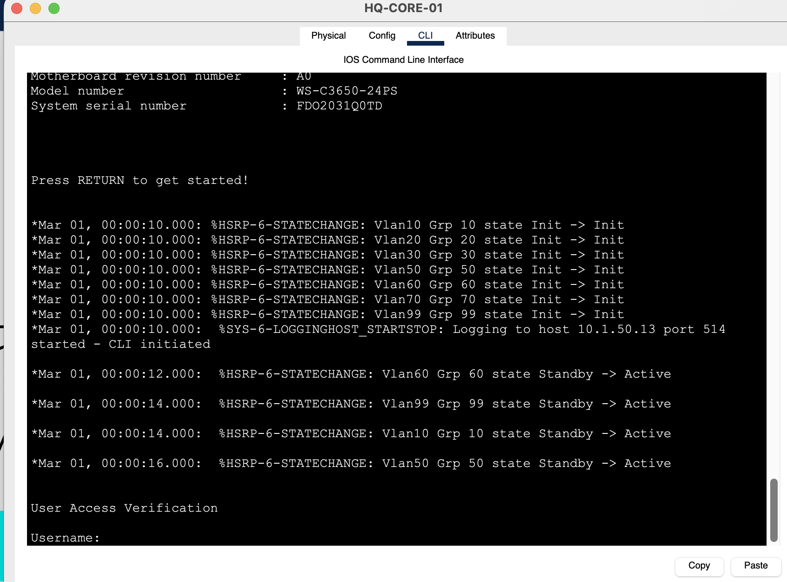
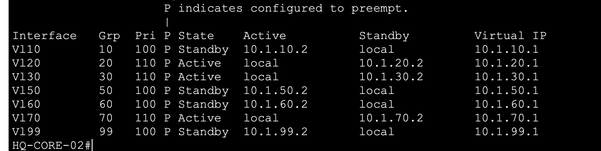

### Test B: Branch WAN Carrier Failure

The Carrier-A link was taken down while BR1-SALES-PC03 pinged an HQ server and the internet.

| Stage | Observation | Screenshot |
|---|---|---|
| Baseline | Branch reaches HQ server 10.1.50.10 | 12a |
| Baseline | 5-hop path through HQ-EDGE-01 (172.16.0.1) | 12b |
| Failure | Carrier-A link down | 12c |
| During | OSPF reroutes both HQ and default routes through 172.16.0.5 (Carrier-B) | 12d |
| During | 1 ping lost to HQ, TTL drops from 124 to 123 (one extra hop) | 12e |
| During | 6-hop backup path: HQ-EDGE-02, then the serial link to HQ-EDGE-01, then the firewall | 12f |
| During | 3 pings lost to the internet, then traffic resumes | 12g |
| Recovery | Path returns to Carrier-A after the link is restored | 12h |

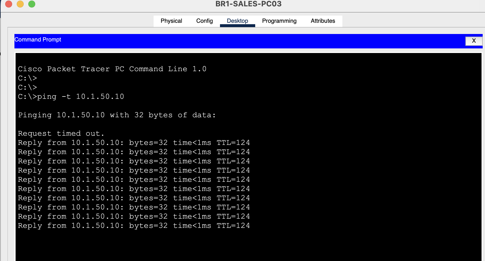
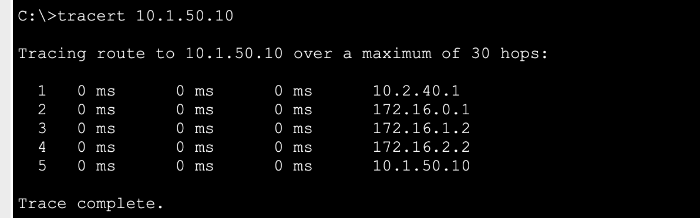
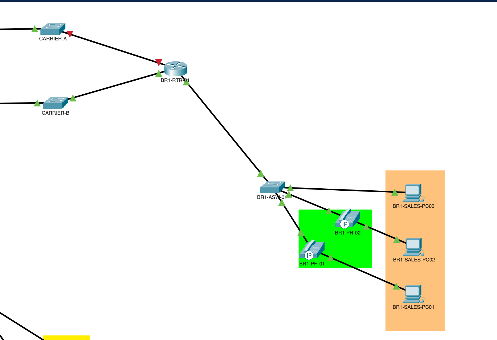
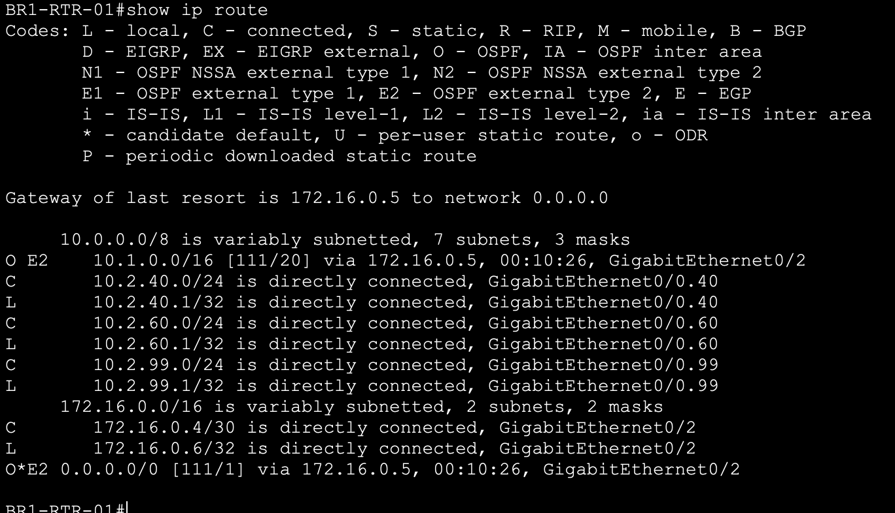
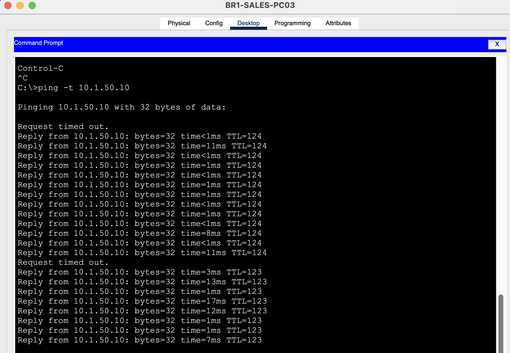


## 11. Troubleshooting Log

Full write-ups with evidence are in [docs/troubleshooting-log.md](docs/troubleshooting-log.md).

| Ticket | Issue | Root cause | Outcome |
|---|---|---|---|
| TKT-001 | HSRP split brain on HR VLAN 20 | HR rules entered into a misnamed ACL (HR-IN), applied ACL (HR_IN) had 1 line, implicit deny dropped HSRP hellos | Fixed |
| TKT-002 | HR PC cannot reach 10.1.20.24 | Test target did not exist | Closed, test corrected |
| TKT-003 | Guest internet reported down | Not reproducible, layered testing showed full connectivity | Closed, no fault found |

The log also covers 13 issues hit during the build (TKT-004 to TKT-016). The three most instructive:

| Ticket | Issue | Root cause | Outcome |
|---|---|---|---|
| TKT-010 | EtherChannel flapping, HSRP active on both cores | LACP instability, a mode mismatch during the change, and a VLAN missing from a trunk | Fixed, Po1 rebuilt |
| TKT-014 | Branch web pages failed while pings worked | Equal-cost default routes split TCP sessions across two edges with different NAT addresses | Fixed |
| TKT-016 | Branch-to-HQ traffic did not fail over | The ASA kept sending replies to the edge that had lost its WAN link | Fixed with an edge cross-link |

## Lab vs Production

Some choices were made to work around Packet Tracer. Each one is listed with what a production network would use instead.

| Area | In this lab | In production |
|---|---|---|
| Core EtherChannel | Static (`mode on`) after LACP was unstable in the simulator | LACP (`mode active`), which detects misconfigured or miswired members |
| ISP failover | Triggers when the link to ISP-A goes down (IP SLA is not supported) | Default route tracked by an IP SLA probe, so an upstream ISP failure also triggers failover |
| Branch exit selection | `distance 111` for routes from HQ-EDGE-02 (`metric`, `metric-type 1` and `maximum-paths` were rejected) | OSPF E1 metrics so the WAN costs choose the path |
| Firewall routing | Static routes on the ASA, plus an edge cross-link to keep return traffic symmetric | Dynamic routing (OSPF or BGP) between the firewall and the edges |
| Firewall inspection | Explicit OUTSIDE_IN entries for ICMP replies, because the simulated ASA did not track them | Stateful inspection handles return traffic, logs go to a SIEM |
| Firewall redundancy | Single ASA with redundant interfaces | Active/standby firewall pair |
| Wireless | Separate small lab, WPA2-Personal | Integrated with the campus, WPA2/WPA3-Enterprise with RADIUS |
| Uplinks | Copper between floors | Fiber between floors |
| SNMP | v2c read-only | v3 with authentication and encryption |

## Repository Layout

```
README.md
multi-site-enterprise-network-lab.pkt   the lab, opens in Packet Tracer 9.0 or later
docs/troubleshooting-log.md             16 tickets in support-ticket format
docs/design-decisions.md                design reasoning and hostname convention
screenshots/                            all images referenced above
configs/                                running-config of every network device, passwords redacted
```

## Future Improvements

| Item | Reason |
|---|---|
| Move unused ports to a dedicated black-hole VLAN | Unused ports currently share VLAN 999 with the native VLAN (they are shut down, which limits the risk) |
| LACP on Port-channel 1 | Currently static (mode on) because LACP was unstable in Packet Tracer (TKT-010). LACP detects misconfigured bundles. |
| Prune the server switch uplink | Gi1/0/3 on both cores allows more VLANs than the server switch needs |
| SNMPv3 | Replace the v2c community string with authenticated, encrypted SNMPv3 |
| Port security on the server switch | Server ports currently rely on DHCP snooping only |
| Config comparison on redundant pairs | Would have caught TKT-001 before it caused an outage |
| Publish the wireless lab | WLC, lightweight APs, and corporate and guest SSIDs, built as a separate file because the full topology became unstable with wireless devices added (TKT-011) |
| Cover the HQ-EDGE-01 to ASA link | The edge cross-link (TKT-016) does not cover a failure of only that link |
