# Troubleshooting Log

Issues found while building and verifying the network. Each ticket follows the same format: symptom, impact, diagnosis, root cause, fix, verification and lesson.

## TKT-001: HSRP Split Brain on HR VLAN 20

| Field | Detail |
|---|---|
| Severity | High |
| Affected | HR VLAN 20 (10.1.20.0/24), gateway 10.1.20.1 |
| Status | Resolved |

### Symptom

Both core switches reported themselves as HSRP Active for VLAN 20. HQ-CORE-01 listed the standby router as "unknown", while HQ-CORE-02 listed HQ-CORE-01 as its standby. Communication was one-way.

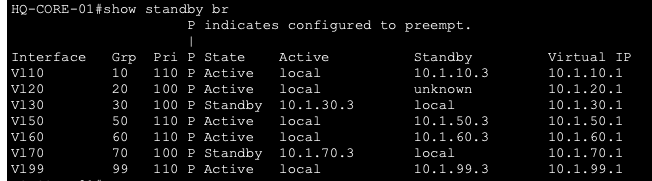
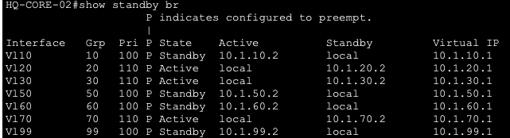

### Impact

Two gateways answered for the same virtual IP and virtual MAC in the HR VLAN, risking intermittent connectivity for HR users. HSRP redundancy for HR was not working as designed.

### Diagnosis

| Step | Command | Finding | Screenshot |
|---|---|---|---|
| 1 | `ping 10.1.20.3` from HQ-CORE-01 | 0/5. Core-01 cannot reach Core-02 on VLAN 20. | 13-tkt001-03 |
| 2 | `show interfaces trunk` on HQ-CORE-02 | VLAN 20 allowed and forwarding on Po1. Trunking ruled out. | 13-tkt001-04 |
| 3 | `show spanning-tree vlan 20` on both cores | All ports forwarding, Po1 is Core-01's root port. STP ruled out. | 13-tkt001-05, 06 |
| 4 | `show access-lists HR_IN` on both cores | Core-01 HR_IN had 1 line. Core-02 had 7. | 13-tkt001-07, 08 |
| 5 | Removed HR_IN from Core-01 VLAN 20 as a test | HSRP converged immediately: Core-01 Standby, Core-02 Active | 13-tkt001-09, 10 |

VLANs 30 and 70 also have inbound ACLs on Core-01 and worked normally, which pointed to something specific to VLAN 20 rather than ACLs in general.

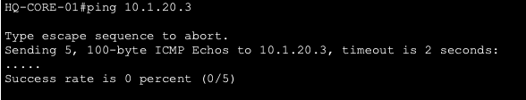
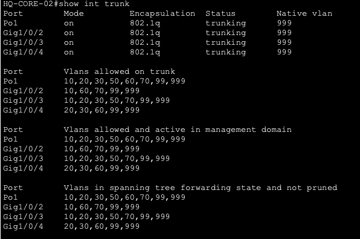
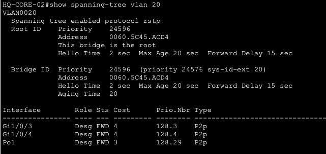
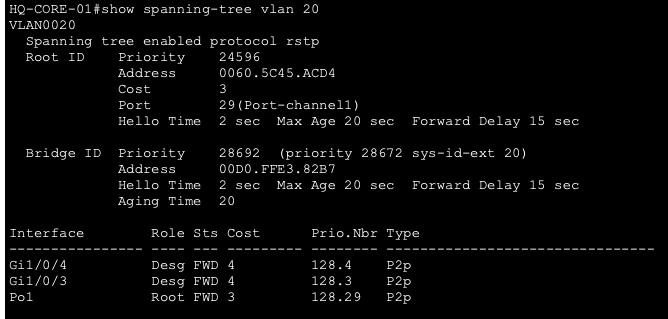
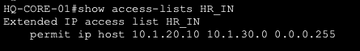
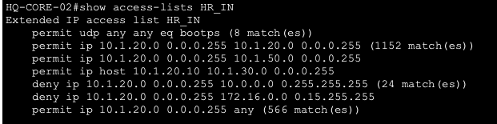
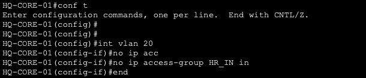
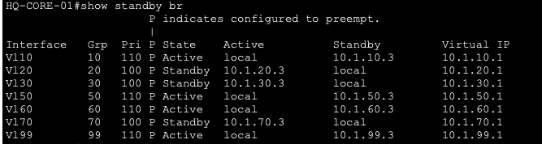

### Root Cause

The HR rules on HQ-CORE-01 had been entered into an ACL named `HR-IN` (hyphen), while the ACL actually applied to VLAN 20 was `HR_IN` (underscore) and contained a single line. The implicit deny at the end of `HR_IN` dropped HQ-CORE-02's HSRP hellos (sent to 224.0.0.2) and its ping replies inbound on VLAN 20. Core-01 never heard Core-02, so it stayed Active.

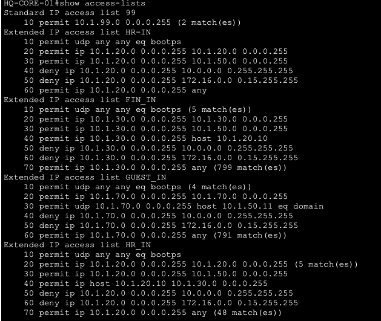
*Both `HR-IN` (unused, no matches) and `HR_IN` present on HQ-CORE-01.*

### Fix

1. Rebuilt `HR_IN` on HQ-CORE-01 to match HQ-CORE-02 line for line.
2. Reapplied it inbound on interface VLAN 20.
3. Removed the orphan `HR-IN`.
4. Saved the configuration.

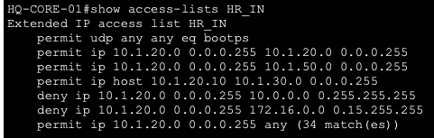

### Verification

| Check | Result | Screenshot |
|---|---|---|
| Core-01 reaches Core-02 on VLAN 20 | 5/5 | 13-tkt001-13-ping-success |
| HSRP VLAN 20 | Core-02 Active, Core-01 Standby, ACL applied | 05-hsrp-hq-core-01, 05-hsrp-hq-core-02 |
| ACLs on Core-01 | Clean list, matches Core-02 | 09-acls-hq-core-01 |

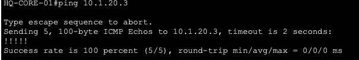

### Lesson

One character in an ACL name created a silent failure that only showed up as a redundancy problem. On redundant pairs, compare configurations after every change, and use one naming convention everywhere.

## TKT-002: HR PC Cannot Reach 10.1.20.24

| Field | Detail |
|---|---|
| Severity | Low |
| Affected | Testing only |
| Status | Closed, test corrected |

### Symptom

HQ-HR-PC-02 could not ping 10.1.20.24, an address in its own VLAN. Same-VLAN traffic never passes through the gateway or the ACLs, so a failure here would mean a Layer 2 problem.

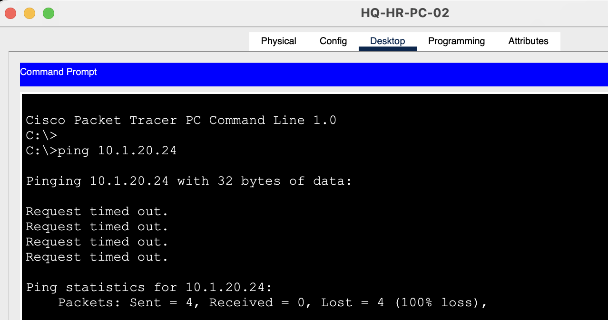

### Diagnosis

| Step | Command | Finding |
|---|---|---|
| 1 | `ipconfig` on HQ-HR-PC-02 | PC is 10.1.20.21 |
| 2 | `ipconfig /all` on HQ-HR-PC-01 | PC is 10.1.20.22 |
| 3 | Compared against the HR VLAN device list | HR hosts are .21, .22 and the printer (.10). Nothing uses 10.1.20.24. |

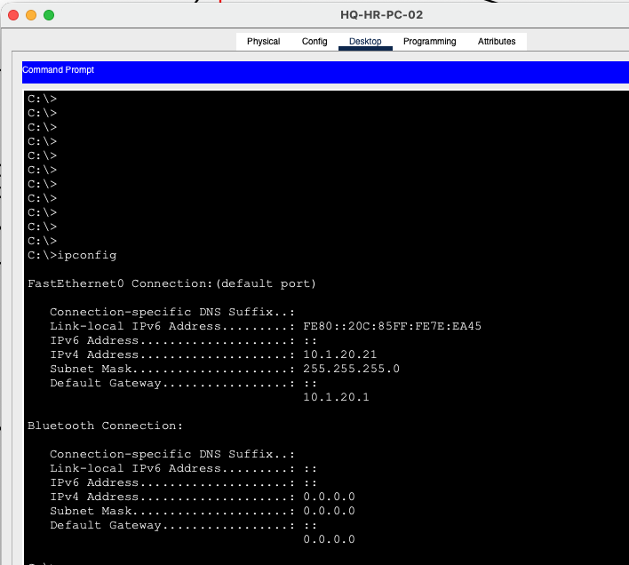

### Root Cause

The test targeted an address that was never assigned. This also affected two earlier ACL deny tests (Guest and Finance to 10.1.20.24), because an ACL block and a missing host both return "Destination host unreachable".

### Fix and Verification

Retested against a real HR host (10.1.20.22). HR to HR succeeds, and the Guest and Finance deny tests were rerun against the real host.

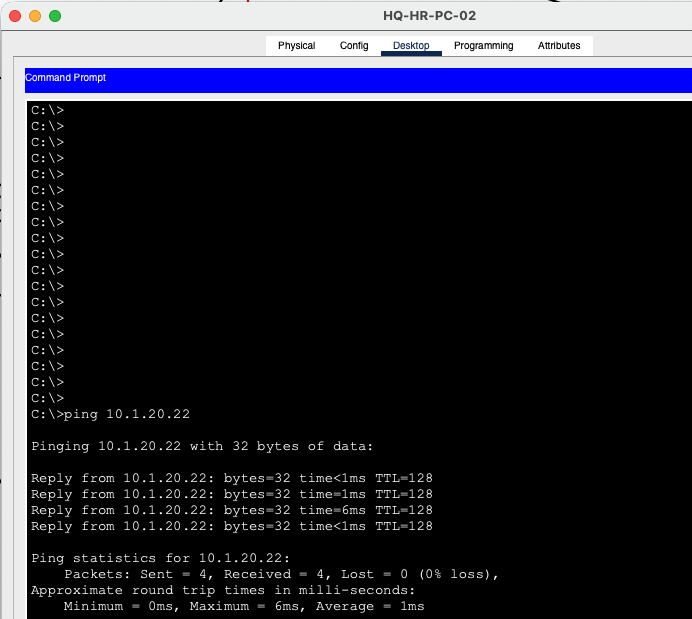

### Lesson

Confirm the target exists before trusting a failed test. A deny test only proves something if the same target is reachable from a permitted source.

## TKT-003: Guest Internet Reported Down

| Field | Detail |
|---|---|
| Severity | Medium |
| Affected | Guest VLAN 70 |
| Status | Closed, no fault found |

### Symptom

A ping to the internet test server 192.0.2.10 failed with 100% loss. The source device was not recorded at the time.

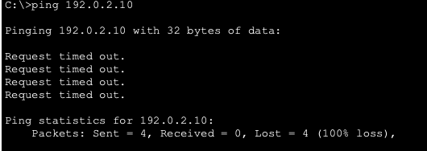

### Diagnosis

Tested from HQ-GUEST-KIOSK-01, working up the path:

| Step | Test | Result |
|---|---|---|
| 1 | Ping gateway 10.1.70.1 | Success |
| 2 | NAT ACL on both edge routers | ACL 1 permits 10.0.0.0/8, which includes the guest subnet |
| 3 | `tracert 192.0.2.10` | Complete: HQ-CORE-02, HQ-FW-01, HQ-EDGE-01, destination. Hop 4 (ISP router) does not answer traceroute, which is normal. |
| 4 | Ping 192.0.2.10 | 4/4 success |

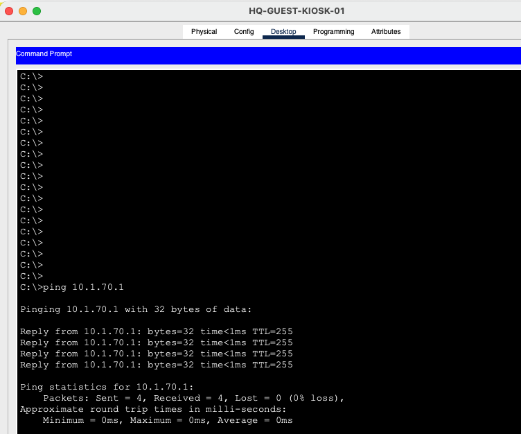
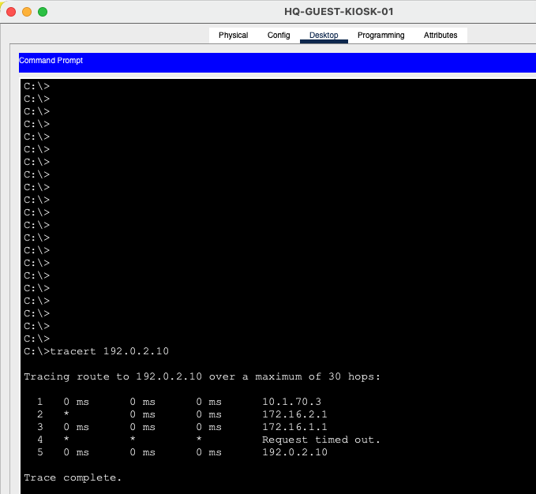

### Root Cause

Not reproducible. The original test was most likely run from a different device or during a failover test.

### Verification

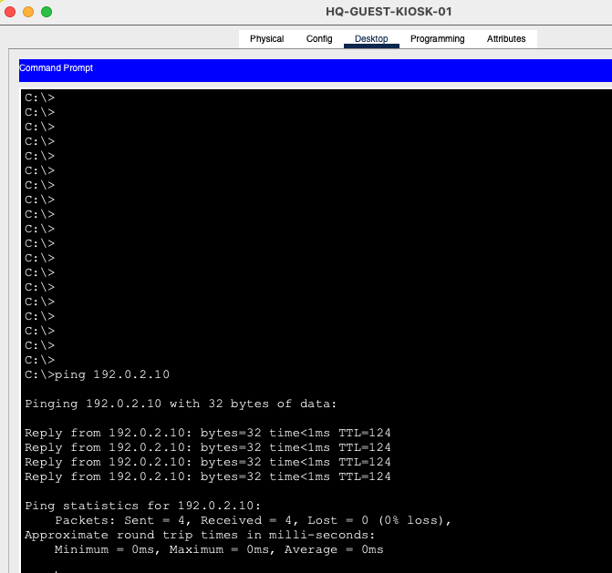

### Lesson

Record the source device with every test. Working bottom-up (gateway, NAT, path, destination) confirmed the guest path in four steps.

---

# Build Issues

Problems hit while building the lab, logged as they happened. Each ticket records the symptom, how it was diagnosed, the root cause, the fix and the lesson. The most instructive ones are marked with a star.

| Ticket | Issue | Area | Root cause |
|---|---|---|---|
| TKT-004 | Locked out of the core switch console | Base config | `login local` with no local user |
| TKT-005 | VLAN 99 blocked on the core downlinks | STP | Root bridge priority not applied |
| TKT-006 | Edge router could not ping the ASA | Firewall | ASA ACL applied to traffic aimed at the ASA itself |
| TKT-007 | HQ PCs could not ping the internet | Firewall | ICMP replies dropped on the outside interface |
| TKT-008 | WLC web page returned "Server Reset Connection" | Wireless | Known Packet Tracer 9.0 bug |
| TKT-009 | WLC unreachable after the setup wizard | Wireless | Native VLAN mismatch on the WLC trunk |
| TKT-010 ★ | EtherChannel flapping, HSRP active on both cores | Core | LACP instability, mode mismatch, missing VLAN on a trunk |
| TKT-011 | Packet Tracer lag and crashes | Lab design | Simulator limits with wireless added |
| TKT-012 | HQ PCs could not load web pages | Firewall | Web replies dropped on the outside interface |
| TKT-013 | Branch router had no default route | OSPF | A rejected command left the feature missing |
| TKT-014 ★ | Branch web pages failed, pings worked | OSPF / NAT | Equal-cost defaults split sessions across two NAT exits |
| TKT-015 | Finance could not reach the HR printer | ACLs | Printer replies blocked by the HR ACL |
| TKT-016 ★ | Branch-to-HQ traffic did not fail over | WAN / Firewall | Asymmetric return path through the firewall |

## TKT-004: Locked Out of the Core Switch Console

| Field | Detail |
|---|---|
| Device | HQ-CORE-01 |
| Symptom | After the base config, the console prompted for a username and no credentials were accepted. |
| Diagnosis | Reviewed the commands entered: `login local` was set on the console and VTY lines, but no `username` command had been entered. |
| Root cause | `login local` authenticates against the local user database, which was empty, so no login could succeed. |
| Fix | Power cycled the switch (the lockout was not yet saved), then reapplied the base config with `username admin privilege 15 secret ...` created before `login local`. |
| Verification | Logged out and back in with the new credentials. Checked the other configured devices for the same mistake. |
| Lesson | Create the local user first, and test the login before running `write memory`. |

## TKT-005: VLAN 99 Blocked on the Core Downlinks

| Field | Detail |
|---|---|
| Device | HQ-CORE-01 |
| Symptom | `show interfaces trunk` listed VLAN 99 as allowed and active, but it was missing from "forwarding and not pruned" on Gi1/0/2 to Gi1/0/4. |
| Diagnosis | `show spanning-tree vlan 99` showed HQ-CORE-01 was not the root bridge for VLAN 99, which the design requires. |
| Root cause | The VLAN 99 root priority was not applied as intended, so STP blocked VLAN 99 on the core downlinks. |
| Fix | Set `spanning-tree vlan 99 priority 24576` on HQ-CORE-01 and 28672 on HQ-CORE-02. Gi1/0/4 briefly showed Altn BLK on the root bridge, and a `shutdown` / `no shutdown` cleared it. |
| Verification | `show spanning-tree vlan 99` showed "This bridge is the root" with every port Desg FWD. |
| Lesson | The STP root should match the HSRP active core for each VLAN. A root bridge should never have a blocking port, so one appearing points to stale state or a link problem. |

## TKT-006: Edge Router Could Not Ping the ASA

| Field | Detail |
|---|---|
| Device | HQ-FW-01 |
| Symptom | Pings from HQ-EDGE-01 to the ASA outside interface (172.16.1.2) failed. |
| Diagnosis | Both interfaces were up/up with correct addresses, cabling matched the plan, and the ASA showed the right nameif and security level. `show arp` on HQ-EDGE-01 had a resolved MAC for 172.16.1.2. |
| Root cause | A resolved ARP entry proved Layer 2 worked, so the ASA was filtering the pings. Packet Tracer's ASA applied OUTSIDE_IN to pings aimed at the ASA itself, and the ACL did not permit ICMP from the edge links. |
| Fix | Permitted ICMP from 172.16.1.0/29 in OUTSIDE_IN. |
| Verification | Both edge routers could ping their ASA interfaces. |
| Lesson | A resolved ARP entry rules out cabling. A failed ping after that points to filtering. |

## TKT-007: HQ PCs Could Not Ping the Internet

| Field | Detail |
|---|---|
| Device | HQ-FW-01 |
| Symptom | HQ PCs could not ping 192.0.2.10, while HQ-EDGE-01 could. |
| Diagnosis | Checked the edge default route, the edge's own internet reachability, the PC-to-edge path and NAT statistics, all correct. Simulation mode with an ICMP filter showed the reply being dropped at the ASA on the way back in. |
| Root cause | Packet Tracer's ASA did not match ICMP replies arriving on the outside interface to the original ping, even with `inspect icmp`, so OUTSIDE_IN dropped them. |
| Fix | Permitted ICMP echo-reply and unreachable in OUTSIDE_IN. |
| Verification | HQ PCs pinged 192.0.2.10 successfully. |
| Lesson | Simulation mode shows exactly which device drops a packet, faster than checking hop by hop. |

## TKT-008: WLC Web Page Returned "Server Reset Connection"

| Field | Detail |
|---|---|
| Device | HQ-WLC-01 (wireless lab) |
| Symptom | Browsing to the WLC from the admin PC and from a server returned "Server Reset Connection". |
| Diagnosis | Pinged the WLC and compared the MAC in `arp -a` with the WLC's own MAC. They matched, ruling out an IP conflict or VLAN problem. Found Cisco community reports of the same error in Packet Tracer 9.0. |
| Root cause | A known bug in the Packet Tracer 9.0 WLC web interface. |
| Fix | Browsed over http (not https) and waited about 30 seconds for the setup page. After the setup wizard, switched to https. |
| Verification | The setup wizard loaded. |
| Lesson | Rule out your own configuration before blaming the tool, then check vendor community forums for known bugs. |

## TKT-009: WLC Unreachable After the Setup Wizard

| Field | Detail |
|---|---|
| Device | HQ-WLC-01, its access switch port (wireless lab) |
| Symptom | After the wizard rebooted the WLC, no device could ping it. |
| Diagnosis | Compared the management VLAN entered in the wizard with the native VLAN on the WLC's switch port, and used `show mac address-table` to see which VLAN the WLC's MAC landed in. Also found the WLC was cabled to Fa0/1, not Fa0/5 as planned. |
| Root cause | The WLC sent management traffic untagged, while its trunk port's native VLAN was 999, so it landed in the wrong VLAN. |
| Fix | Set `switchport trunk native vlan 50` on the WLC port and kept the management interface untagged. Updated the port documentation. |
| Verification | The WLC answered pings at 10.1.50.20. |
| Lesson | Tagged and untagged must match on both ends of a trunk. The MAC address table shows which VLAN a device is really in. |

## TKT-010 ★: EtherChannel Flapping, HSRP Active on Both Cores

| Field | Detail |
|---|---|
| Device | HQ-CORE-01, HQ-CORE-02, HQ-SRV-SW-01 |
| Symptom | Links across HQ kept flickering, `show standby brief` showed both cores Active for some VLANs, and Packet Tracer crashed repeatedly. |
| Diagnosis | `show logging` showed Port-channel1 going down and up every few seconds. `show etherchannel summary` showed the members stand-alone (I) and Po1 down (SD). `show interfaces port-channel 1` listed only one member and a rising reset count. `show standby brief` listed the standby router as "unknown", and `show interfaces trunk` on HQ-SRV-SW-01 showed VLAN 70 missing from its uplink to Core-01. |
| Root cause | Three problems stacked up. LACP was unstable in Packet Tracer. While switching to a static channel, the cores were briefly in different modes (one static, one LACP), and the existing Port-channel1 kept its LACP setting until it was deleted. Separately, VLAN 70 was missing from the server switch uplink, so the cores could not hear each other's VLAN 70 HSRP hellos. |
| Fix | Shut the members on one core to stop the flapping and stabilize the simulator. Deleted Port-channel1 and rebuilt it as a static channel (`channel-group 1 mode on`) on both cores, then reset the member ports so they bundled. Added VLAN 70 to the HQ-SRV-SW-01 uplink. HSRP hold time was raised temporarily while the simulator was unstable and returned to the default once Po1 was stable. |
| Verification | `show etherchannel summary` showed Po1 (SU) with both members (P) on both cores, and `show standby brief` showed one Active and one Standby per VLAN. |
| Lesson | Both ends of an EtherChannel must use the same mode, and one unstable core link can break HSRP and STP across a whole site. Production would use LACP because it detects mismatches. Saving the .pkt file regularly also matters, because `write memory` alone does not protect against a simulator crash. |

## TKT-011: Packet Tracer Lag and Crashes With Wireless Added

| Field | Detail |
|---|---|
| Device | Whole lab |
| Symptom | After reopening the file, the network ran cleanly at first, then degraded within minutes. Core-to-core pings dropped with 75 to 240 ms round trips, and Packet Tracer crashed. |
| Diagnosis | Po1 reset counters and STP were stable, and the logs showed only HSRP changes, so the network itself was not changing. Two directly connected switches should answer in under 10 ms. |
| Root cause | Packet Tracer 9.0 could not keep up with the full topology plus the WLC, access points and wireless clients. |
| Fix | Split the project into two files: this main lab (full wired network) and a separate small wireless lab. Removed the WLC, APs and wireless clients from the main lab, parked their ports, and added a wired guest kiosk in VLAN 70 so guest isolation can still be demonstrated. |
| Verification | The main lab stayed stable after reopening, with fast, reliable core-to-core pings. |
| Lesson | Know the limits of your tools. Splitting a large design into focused labs keeps each one testable. |

## TKT-012: HQ PCs Could Not Load Web Pages

| Field | Detail |
|---|---|
| Device | HQ-FW-01 |
| Symptom | HQ PCs got "Request Timeout" for http://www.example.com, while pings to the internet worked. |
| Diagnosis | Both web servers had HTTP enabled. The pattern matched TKT-007, but for web traffic. |
| Root cause | Packet Tracer's ASA did not match web server replies to the original connection, so OUTSIDE_IN dropped them. |
| Fix | Added `inspect http` to the global policy. |
| Verification | HQ PCs loaded http://www.example.com. |
| Lesson | A real ASA tracks these connections automatically. In the simulator, each traffic type needed explicit handling. |

## TKT-013: Branch Router Had No Default Route

| Field | Detail |
|---|---|
| Device | HQ-EDGE-01, HQ-EDGE-02, BR1-RTR-01 |
| Symptom | Branch PCs could not reach the internet, while HQ could. |
| Diagnosis | `show ip route` on BR1-RTR-01 had no default route. |
| Root cause | The `default-information originate metric ...` lines had been rejected (Packet Tracer does not accept the metric option), so neither edge advertised a default into OSPF. HQ was unaffected because the ASA uses a static default to HQ-EDGE-01. |
| Fix | Added plain `default-information originate` under `router ospf 1` on both edges. |
| Verification | BR1-RTR-01 showed an O*E2 default route. |
| Lesson | Check that every command was actually accepted. A rejected line can leave a feature silently missing. |

## TKT-014 ★: Branch Web Pages Failed While Pings Worked

| Field | Detail |
|---|---|
| Device | BR1-RTR-01 |
| Symptom | Branch PCs could ping the internet, but web pages failed with "Server Reset Connection". HQ worked. |
| Diagnosis | `tracert 192.0.2.10` from a Sales PC showed HQ-EDGE-01 followed by ISP-B, a mixed path. The branch routing table had two equal-cost default routes, one through each edge. |
| Root cause | Both edges advertised the default route with the same E2 metric, so the branch load-balanced across both. Each edge translates to a different public IP, so packets from one TCP session arrived at the server from two different addresses and the connection reset. Ping worked because each ICMP packet stands alone. Packet Tracer did not accept `metric`, `metric-type 1` or `maximum-paths` to fix it the usual way. |
| Fix | On BR1-RTR-01, gave routes learned from HQ-EDGE-02 a higher administrative distance (`distance 111 2.2.2.2 0.0.0.0` under `router ospf 1`), then cleared the OSPF process and the NAT translations on both edges. |
| Verification | Repeated traceroutes always went through HQ-EDGE-01 and ISP-A, and the branch loaded http://www.example.com. The Carrier-B routes still install when Carrier-A fails (Failover Test B in the README). |
| Lesson | With NAT at multiple exits, every packet of a session must leave through the same exit. Production would use OSPF E1 metrics so the WAN costs choose the path. |

## TKT-015: Finance Could Not Reach the HR Printer

| Field | Detail |
|---|---|
| Device | HQ-CORE-01, HQ-CORE-02 |
| Symptom | Finance PCs could not ping the HR printer (10.1.20.10), even though FIN_IN permitted it. |
| Diagnosis | FIN_IN matched the request. The printer's replies enter the core on VLAN 20, so they are checked by HR_IN. |
| Root cause | HR_IN denied VLAN 20 traffic to every other internal network, including the printer's replies to Finance. |
| Fix | Added `permit ip host 10.1.20.10 10.1.30.0 0.0.0.255` to HR_IN on both cores, above the deny. |
| Verification | Finance PCs could ping and print to 10.1.20.10, while HR to Finance stayed blocked. |
| Lesson | When both VLANs have inbound ACLs, a shared resource needs rules in both directions. |

## TKT-016 ★: Branch-to-HQ Traffic Did Not Fail Over to Carrier-B

| Field | Detail |
|---|---|
| Device | HQ-EDGE-01, HQ-EDGE-02, HQ-FW-01 |
| Symptom | With the Carrier-A link down, the branch rerouted through Carrier-B, but pings from the branch to HQ servers failed. |
| Diagnosis | The branch routing table had switched to HQ-EDGE-02 correctly, so the problem was the return path. Traced it from HQ: the ASA kept sending replies to HQ-EDGE-01, which had lost its only link to the branch. Running OSPF on the ASA was tried, but Packet Tracer's ASA did not form adjacencies, so that config was removed. |
| Root cause | The ASA uses static routes and cannot see WAN failures, and HQ-EDGE-01 had no other path to the branch. |
| Fix | Added a serial cross-link between the edge routers (HWIC-2T, 172.16.0.8/30) running OSPF, with `ip nat inside` on both ends. Changed HQ-EDGE-02's route to HQ to go through HQ-EDGE-01 (172.16.0.9), with a floating backup through the ASA (AD 200), so branch-to-HQ traffic enters the ASA on outside1 in both directions. |
| Verification | With Carrier-A down, Sales PC pings to 10.1.50.10 resumed, HQ-EDGE-01 learned the branch routes through 172.16.0.10, and the traceroute went HQ-EDGE-02, cross-link, HQ-EDGE-01, ASA. See Failover Test B in the README. |
| Lesson | Failover testing exposes design gaps that a working network hides. Interconnected edge routers let each edge reach every site, and keeping traffic symmetric through a stateful firewall avoids drops. Remaining edge case: a failure of only the HQ-EDGE-01 to ASA link is not covered. |
